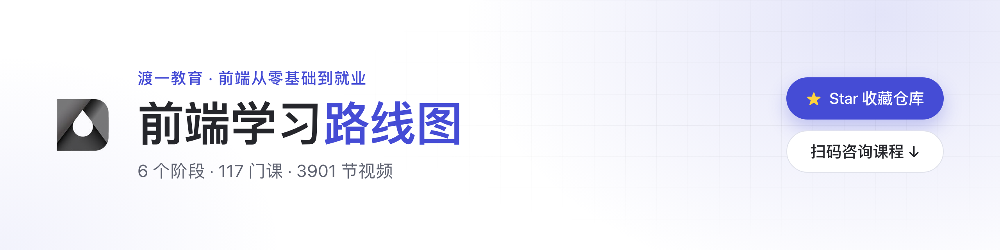

<picture>
  <source media="(prefers-color-scheme: dark)" srcset="./assets/banner-dark.png">
  
</picture>

给大学生的前端学习路线：从零基础到进阶分成 6 个阶段，每个阶段写清楚要学什么、看什么资料、做什么练习。

## 加入前端学习群

学的时候卡住了，或者想找人一起学，扫下面的二维码或者点[这里](https://t.me/+vYIBxALuDpY0ZmZk)加入前端学习群。群里交流学习问题，分享资料。

  

## 怎么用

1. 从阶段 1 往下学，已经会的阶段可以跳过。
2. 每个阶段先看「要掌握」，再用「推荐资料」学，做完「练习」再进下一阶段。
3. 建议时长按每天学 2～3 小时估算。考试周放慢没关系，但别跳过练习。
4. 觉得有用就点个 Star，路线更新后方便找回来。

## 路线总览

| 阶段 | 内容 | 建议时长 |
| :-: | --- | --- |
| 1 | [HTML · CSS 基础](#阶段-1html--css-基础) | 3～4 周 |
| 2 | [JavaScript 核心](#阶段-2javascript-核心) | 6～8 周 |
| 3 | [Vue / React 框架](#阶段-3vue--react-框架) | 6～8 周 |
| 4 | [工程化 · TypeScript](#阶段-4工程化--typescript) | 4～6 周 |
| 5 | [项目实战](#阶段-5项目实战) | 6～8 周 |
| 6 | [进阶：源码 · AI 应用](#阶段-6进阶源码--ai-应用) | 长期 |

## 阶段 1：HTML · CSS 基础

**要掌握**

- 语义化标签、表单、表格、图片和多媒体
- 盒模型、选择器和优先级、常用单位
- 布局：Flex、Grid、定位
- 响应式：媒体查询、移动端适配
- 用浏览器开发者工具查元素、调样式

**推荐资料**

- [MDN：学习 Web 开发](https://developer.mozilla.org/zh-CN/docs/Learn_web_development)：从 HTML、CSS 到 JavaScript 的系统教程
- [Flexbox Froggy](https://flexboxfroggy.com/#zh-cn)：用小游戏练 Flex 布局
- [Grid Garden](https://cssgridgarden.com/#zh-cn)：用小游戏练 Grid 布局

**练习**

- 挑一个你常用的网站，照着把首页静态还原出来，手机和电脑上都要能正常看。
- 做一个个人简介页，用 GitHub Pages 发布上线。

## 阶段 2：JavaScript 核心

**要掌握**

- 变量、类型、函数、作用域和闭包
- 对象、原型、`this`、class
- 数组和字符串的常用方法
- DOM 操作和事件
- 异步：回调、Promise、`async/await`、事件循环
- 用 `fetch` 请求接口、处理 JSON
- ES6+ 常用语法：解构、展开、模块

**推荐资料**

- [现代 JavaScript 教程](https://zh.javascript.info/)：从基础讲到进阶，配练习题
- [MDN：JavaScript 指南](https://developer.mozilla.org/zh-CN/docs/Web/JavaScript/Guide)：查语法和 API
- [ES6 入门教程](https://es6.ruanyifeng.com/)：阮一峰写的 ES6+ 语法教程

**练习**

- 不用框架写一个待办清单：增删改查、筛选，数据存在 `localStorage` 里。
- 调一个公开接口（比如天气），做一个查询页面，把加载中和出错的情况处理好。

## 阶段 3：Vue / React 框架

先选一个学透，Vue 和 React 都行。学会一个，再学另一个会快很多。

**要掌握**

- 组件、props、事件，以及插槽（Vue）或 children（React）
- 响应式状态和计算属性（Vue），state 和 Hooks（React）
- 路由：Vue Router 或 React Router
- 状态管理：Pinia（Vue）或 Redux Toolkit、Zustand（React）
- 组件库：Element Plus 或 Ant Design

**推荐资料**

- [Vue 官方文档](https://cn.vuejs.org/)，配套的 [Vue Router](https://router.vuejs.org/zh/) 和 [Pinia](https://pinia.vuejs.org/zh/)
- [React 官方文档](https://zh-hans.react.dev/)
- 组件库：[Element Plus](https://element-plus.org/zh-CN/)、[Ant Design](https://ant.design/index-cn)

**练习**

- 用框架重写阶段 2 的待办清单，加上路由，拆成多个页面。
- 做一个电影或图书列表：搜索、分页、详情页，数据来自公开接口。

## 阶段 4：工程化 · TypeScript

**要掌握**

- Git：分支、合并、解决冲突，用 GitHub 和别人协作
- npm 或 pnpm：安装依赖、写脚本、看懂 `package.json`
- Vite：创建项目、本地开发、打包
- TypeScript：基础类型、接口、泛型，并在 Vue 或 React 项目里用起来
- 代码规范：ESLint、Prettier

**推荐资料**

- [Pro Git 中文版](https://git-scm.com/book/zh/v2)
- [Vite 官方文档](https://cn.vite.dev/)
- [TypeScript 教程](https://wangdoc.com/typescript/)：阮一峰写的中文教程
- [TypeScript 官方手册](https://www.typescriptlang.org/docs/handbook/intro.html)（英文）

**练习**

- 用 Vite 和 TypeScript 搭一个项目，配好 ESLint 和 Prettier，推到 GitHub。
- 用 GitHub Actions 把项目自动部署到 GitHub Pages。

## 阶段 5：项目实战

完整做两三个项目，比零散学十个知识点更有用。每个项目都放到 GitHub 上，README 写清楚做了什么、怎么运行。

**项目参考**

- 个人博客或作品集：用 Markdown 写文章，部署上线
- 后台管理系统：登录、路由权限、表格和表单、图表
- 移动端 H5 页面：适配不同屏幕，处理触摸交互
- 课设或毕设：和后端联调，把接口、部署都走一遍

**推荐资料**

- [GitHub Pages 文档](https://docs.github.com/zh/pages)
- [ECharts](https://echarts.apache.org/zh/index.html)：做图表
- [MDN：HTTP](https://developer.mozilla.org/zh-CN/docs/Web/HTTP)：联调前把请求、状态码、跨域弄清楚

## 阶段 6：进阶：源码 · AI 应用

**框架源码**

- 弄懂 Vue 的响应式和虚拟 DOM、React 的 Fiber 和 Hooks 是怎么实现的
- 读源码前，先自己写一个简化版，再对照官方实现看
- 源码仓库：[vuejs/core](https://github.com/vuejs/core)、[react/react](https://github.com/react/react)

**AI 应用**

- 用 AI 编程助手提高效率，但要看得懂、改得动它写的代码
- 在前端接入大模型接口：流式输出、多轮对话
- 了解检索增强生成（RAG）和智能体（Agent）的基本做法
- 参考：[AI SDK](https://ai-sdk.dev/)、[LangChain.js](https://docs.langchain.com/oss/javascript/langchain/overview)

## 一起完善

发现资料失效，或者有更好的推荐，欢迎提 Issue 或 PR。学习中遇到问题，到[学习群](https://t.me/+vYIBxALuDpY0ZmZk)里问。
